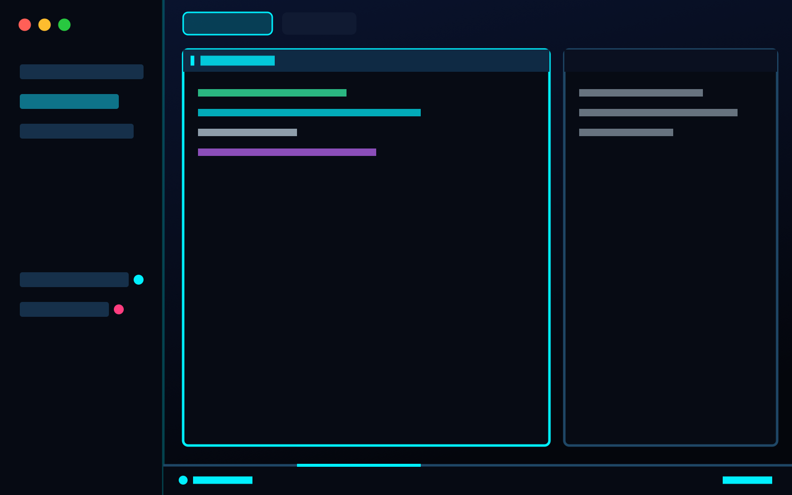

# Neon for Herdr

A cyberpunk control-room layout for [Herdr](https://herdr.dev): a deep navy
window with electric-cyan accents, terminals framed as glowing cards, a HUD
status bar, and a short boot screen when the app starts.



## Features

- **Boot screen**: "NEON // HERDR" runs a short diagnostic using your real
  numbers (spaces, tabs, terminals, agents), then closes by itself. Click or
  press Esc to skip.
- **Pane cards**: each pane gets a `[ PROGRAM ]` header showing its folder,
  git branch and agent status (`RUNNING`, `NEEDS YOU`, `COMPLETE`, `IDLE`).
  Hover a header to split, zoom or close the pane.
- **HUD bar**: system, node, branch, agents by status (with a pulsing
  `▲ ATTENTION` when one needs you), listening dev ports, command palette,
  date and clock.
- **Sidebar**: spaces and agents, plus the Files and Changes panels from the
  tab bar.
- **Theme**: `neon-grid`, with cyan for working, pink for blocked and green
  for done.

## Install

The easiest way is to ask an agent inside Herdr to add
`herdr.dev/layouts/alingavriliuc/herdr-neon`.

To install by hand:

```sh
git clone https://github.com/alingavriliuc/herdr-neon.git
cd herdr-neon
H=~/.config/herdr-app
cp -n layouts/neon.json layouts/neon.svg "$H/layouts/"
cp -n themes/neon-grid.json "$H/themes/"
for m in mods/*; do cp -Rn "$m" "$H/mods/"; done
for m in neon-boot neon-hud neon-pane neon-spaces; do herdr-app check "$H/mods/$m"; done
herdr-app do layout.switch --name neon
```

`cp -n` never overwrites your files. If you already have a layout, theme or
mod with one of these names, rename the new one first and update the
references to it in `layouts/neon.json`.

To switch back to your previous layout, press `ctrl-shift-l`. To uninstall,
delete the files you copied.

## What's inside

| Path | Role |
|---|---|
| `layouts/neon.json`, `layouts/neon.svg` | the layout and its picture in Settings |
| `themes/neon-grid.json` | the color theme |
| `mods/neon-boot` | boot screen |
| `mods/neon-hud` | bottom HUD bar |
| `mods/neon-pane` | pane header |
| `mods/neon-spaces` | spaces list (a clone of Herdr's `spaces`) |
| `RECIPE.md` | full brief to rebuild the layout from scratch |

The layout also uses Herdr's shipped mods `workspace-chrome`, `agents`,
`tabs`, `files` and `changes`.

## Good to know

- `neon-hud` runs `lsof` and `ps` locally every 5 seconds to list
  listening dev ports. It makes no network calls. On Windows the `PORTS`
  segment stays empty.
- Clicking `PORTS` opens a mod named `lk-ports`, which isn't included here.
  Without it, nothing opens.
- The boot screen shows once per app launch. To see it again, run
  `herdr-app do mod.open --name neon-boot`.
- The layout hides the system title bar. On Linux and Windows, it draws no
  window buttons.
