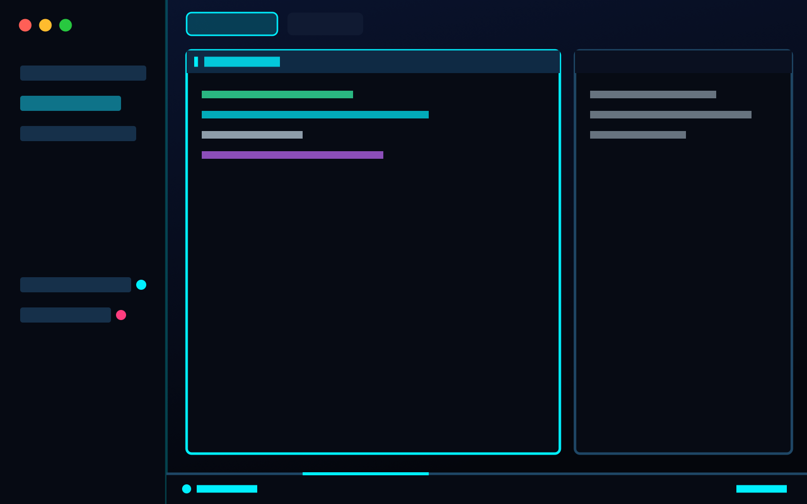

# Neon

A dark cyberpunk control room for Herdr: a deep navy gradient window with
electric-cyan accents, a sidebar of spaces and agents, terminals framed as
glowing cards with a `[ PROGRAM ]` header and a status chip, and a HUD status
bar along the bottom (system, node, branch, agents by status, listening dev
ports, date and clock). On launch, a short "NEON // HERDR" boot screen runs a
diagnostic using the app's real numbers, then closes by itself.

## What you see

Left to right:

- **Sidebar**, 260px wide (not resizable), background `#060a13e6`:
  - **Brand bar**, 46px, the shipped `workspace-chrome` (drag to move the window).
  - **Spaces** (top half) and **Agents** (bottom half), equal weights, min 90px
    each, separated by a 1px `border` divider. Spaces is `neon-spaces`; Agents
    is the shipped `agents` mod.
  - **Footer**, 69px, `workspace-chrome` with `props: { footer: true }`
    (Settings, Add machine).
- **Work column** (the rest):
  - **Tab bar**, 42px, shipped `tabs`, 1px border `#00f0ff22`, window-draggable.
  - **Work body**, padding 12, gap 12:
    - **Main**: the active tab's panes. Each pane is a card: radius 4,
      background `#070b14`, 1px border `#1f4766`, 1px `#00f0ff` border when
      focused, gap 12 between panes, framed even when alone. Each pane has a
      28px header on top (`neon-pane`), always visible.
    - **Panel** (hidden by default), 368px (280–900), radius 4, border
      `#1f4766`: a stack of the shipped `files` and `changes` mods, opened from
      the tab bar's Files / Changes buttons.
  - **HUD**, 28px, `neon-hud`.

Look (root): theme `neon-grid` (`themes/neon-grid.json`: background
`#070b14`, foreground `#d6f4ff`, accent `#00f0ff`, working `#00f0ff`, blocked
`#ff3d7f`, done `#39ffb0`, idle `#4a6886`), terminal font JetBrains Mono, UI
font Geist Mono, terminal padding [14, 12], terminal opacity 0.86, window
background a 160° gradient `#0a1430` → `#04060c`, root divider 1px
`#00f0ff33`, no system title bar (`"titlebar": "none"`), macOS traffic lights at
[12, 16].

**Pane header** (`neon-pane`), 11px text: a 3×12 bar (accent when focused, dim
otherwise), `[ PROGRAM NAME ]` in caps (accent when focused, max 240px), the
folder (`~`-shortened, dim, truncated), the git branch `⎇ name` in `ansi13`,
then a status chip (10px semibold, tinted background `+1f`, border `+66`).
Focused header background `selected` at 50% with an accent bottom border.

**HUD** (`neon-hud`), 11px, `chrome` background, `input` top border, 14px
side padding, segments separated by 1×12 `border` lines:
`● SYS//ONLINE` (accent) · `NODE LOCAL` (or the space's machine, upper case) ·
`BR <branch>` (`ansi13`, only in a repo) · `AGENTS 03` (two digits) ·
`RUN n` (working color, if any) · `OK n` (done color, if any) ·
`▲ n ATTENTION` (blocked, pulsing) … then on the right `PORTS 3000·5173 +2`
(`ansi11`, `—` when none, at most 4 shown) · `⌘ CMD` · `2026.11.03` (dim) ·
`22:21` (accent).

**Boot screen** (`neon-boot`): a 620×460 frameless dialog, `canvas`
background, 1px accent border at `99` alpha, radius 4, padding 28, JetBrains
Mono 12px. Title row: a 4×30 accent bar, `N E O N` (30px bold accent), `//`
(dim), `H E R D R` (30px bold foreground); under it `TERMINAL OPERATIONS
INTERFACE · v1` (10.5px dim). Then six lines appear one by one, each
`[ OK ]` in the done color (or `[ !! ]` in the blocked color):

1. `herdr-core kernel online · macOS` (Linux / Windows)
2. `Nodes: local + N remote`
3. `N spaces · N tabs restored`
4. `N terminals attached`
5. `N agents detected · N active · N waiting` (`!!` when an agent is waiting)
6. `neon-grid interface loaded`

Then a 32-cell progress bar `[████░░░░] 75%` in accent, and at the bottom
`initializing...` (animated dots) turning into `▶ SYSTEM READY` (accent), with
`click or Esc to skip` on the right.

## How it behaves

- Agent status in the pane header chip: working → `RUNNING` with a spinning
  `◜◠◝◞◡◟` glyph (110 ms), cyan; blocked → `NEEDS YOU`, pink, pulsing opacity
  0.45–1 over 800 ms; done → `COMPLETE`, green; idle → `IDLE`, dim.
- HUD: `RUN`, `OK` and `▲ ATTENTION` appear only when their count is above
  zero; ATTENTION pulses 0.5–1 over 900 ms on a pink tint.
- Hovering a pane header shows four buttons: split right, split down,
  zoom/unzoom, close. Clicking the header focuses the pane.
- HUD `⌘ CMD` opens the command palette; `PORTS` opens the `lk-ports` mod (not
  included, see Watch out).
- The boot screen opens once per app launch (not on hot reload), adds a line
  every 160 ms, holds `SYSTEM READY` for 900 ms, then closes. Clicking it or
  pressing Esc closes it at once.
- Spaces list: same as Herdr's `spaces` (colored avatars, worktrees under
  their repo, branch and ahead/behind, grouped by machine, drag to reorder,
  right-click menu), with pointer cursors and 4px between rows.
- The clock updates every 15 s; ports are re-scanned every 5 s.

## Built from

- `layouts/neon.json`: root `row` → `sidebar` column (`brand` block,
  `sidebar-lists` column with `spaces` + `agents` blocks, `sidebar-footer`
  block) and `work` column (`tabs` block, `work-body` row with `main`
  `{ "tab": "active" }` block and hidden `panel` column → `panel-body` stack of
  `files` / `changes`, then `status` block). Preview: `layouts/neon.svg`.
- `themes/neon-grid.json`: the theme the layout names.
- Shipped mods used: `workspace-chrome`, `agents`, `tabs`, `files`,
  `changes`; icons from `mods/pane/*.svg` (pane header buttons) and
  `mods/workspace-chrome/*.svg` (spaces).
- `mods/neon-spaces`: a clone of the shipped `spaces` 0.1.12 (`mod.clone`),
  with `cursor_pointer()` on clickable rows/buttons and `gap(4)` on the list.
- `mods/neon-pane`: pane header; reads `panes()`, `props().pane`, `home()`;
  runs `pane.focus`, `pane.split`, `pane.zoom`, `pane.close`.
- `mods/neon-hud`: reads `spaces()`, `agents()`; runs `app.palette`,
  `mod.open {name: "lk-ports"}`, and on first render `mod.open {name:
  "neon-boot"}` guarded by `globalThis.__neonBooted`. Runs `lsof -nP -iTCP
  -sTCP:LISTEN -Fpn` and `ps -o pid=,comm=` every 5 s; drops executables under
  `/System/`, `/usr/libexec|sbin/`, `/Library/`, `/Applications/`, `/sbin/`
  and ports ≥ 49152.
- `mods/neon-boot`: `mod.json` overlay `{ kind: "dialog", frame: "none",
  width: 620, height: 460 }`; reads `spaces()`, `agents()`, `terminals()`,
  `machines()`, `window().platform`; closes with `closeOverlay(props().overlay)`.

## Watch out

- **Runs programs:** `neon-hud` runs `lsof` and `ps` locally every 5 s. No
  network access, no files read outside the mods.
- The `PORTS` click opens `lk-ports`, a personal mod not shipped here. Without
  it, `mod.open` fails with `no mod folder "lk-ports"` and nothing opens.
  Remove the `.on_click` or point it at your own mod.
- The port scan relies on `lsof` (macOS / Linux); on Windows `PORTS` stays `—`.
- The boot guard lives on `globalThis`: it fires once per app launch, not per
  layout switch. Open it by hand with `herdr-app do mod.open --name neon-boot`.
- The sidebar is fixed at 260px (`resizable: false`); folding it below 160px
  switches `neon-spaces` to its compact rail.
- `"titlebar": "none"`: on Linux/Windows the layout draws no window buttons.

## Done when

- `herdr-app check` passes for `mods/neon-boot`, `neon-hud`, `neon-pane`,
  `neon-spaces`, and `layout.switch {"name":"neon"}` shows the gradient window
  with no `layout.error`.
- `herdr-app do mod.open --name neon-boot` shows the six diagnostic lines with
  the real space, tab, terminal and agent counts, reaches 100% and
  `▶ SYSTEM READY`, then closes by itself after about 2 s.
- A pane running an agent shows `[ CLAUDE CODE ]` (or its program) and a
  `RUNNING` chip; a blocked agent makes the chip read `NEEDS YOU` and the HUD
  show a pulsing `▲ 1 ATTENTION`.
- Starting `python3 -m http.server 8000` makes `PORTS 8000` appear in the HUD
  within 5 s.
- Hovering a pane header shows the split/zoom/close buttons, and they work.
